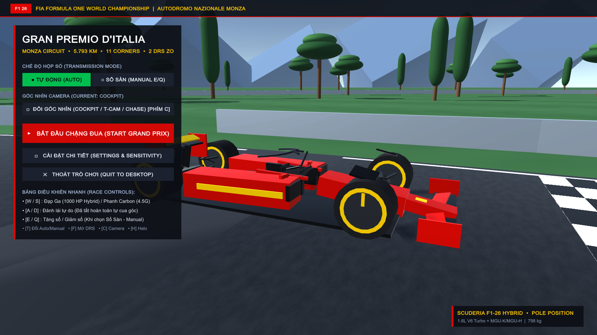
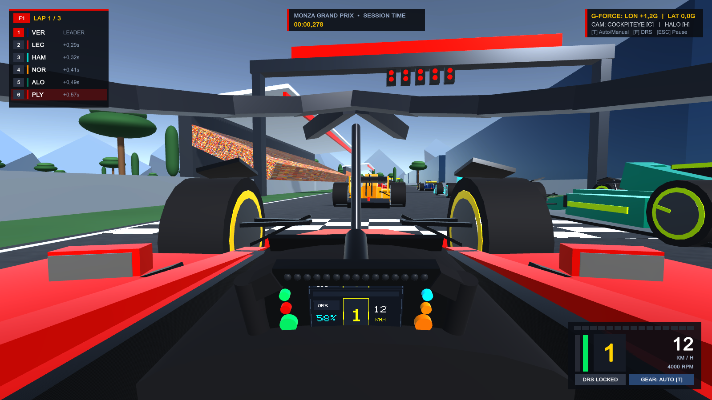
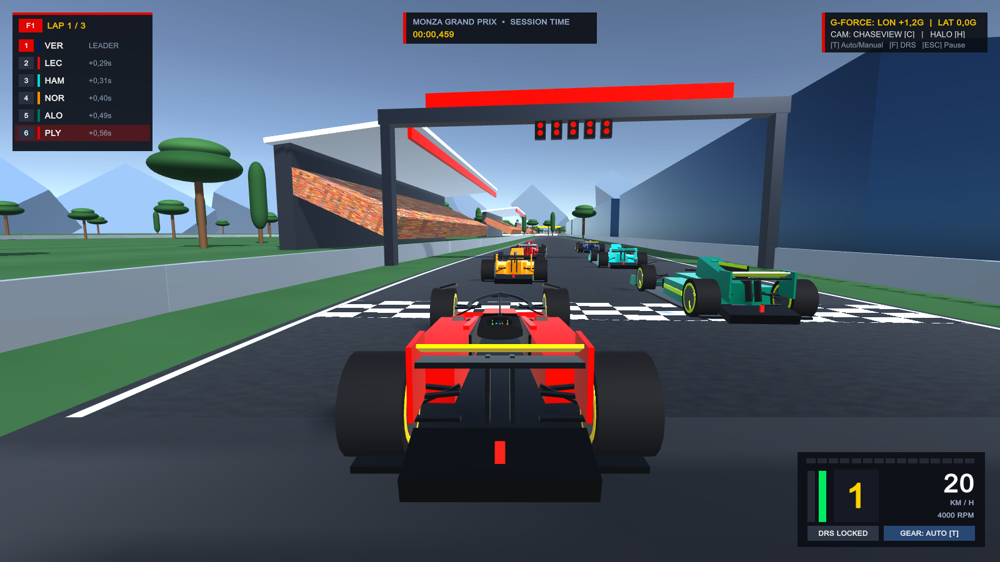

# 🏎️ F1 Simulation Racing — Monza Grand Prix (Unity 6 URP)

[](https://unity.com)
[](tests/)
[](Build/)
[](LICENSE)

An authentic, high-fidelity Formula 1 racing simulation game built on **Unity 6 Universal Render Pipeline (URP)** featuring realistic vehicle dynamics, 3D Monza circuit, 5 AI competitors, authentic cockpit perspective, and broadcast telemetry.

> [!NOTE]
> **Execution Platform Notice**: Real-time interactive gameplay, rendering, audio, and UI are **100% focused and developed on Unity 6 URP**. The Python codebase is retained solely as an offline deterministic physics benchmark and CI unit validation suite.

---

## 📸 In-Game Showcase

| 🏁 Main Menu | 🏎️ Cockpit Camera | 🚀 Chase Camera |
| :---: | :---: | :---: |
|  |  |  |

---

## ⚡ Architecture: Unity 6 URP Game & Physics Benchmarks

```
┌─────────────────────────────────────────────────────────────────────────┐
│              FORMULA 1 GRAND PRIX SIMULATION (UNITY 6 URP)              │
├────────────────────────────────────┬────────────────────────────────────┤
│    🎮 Unity 6 URP 3D Racing Game   │   🐍 Offline Physics Benchmarks    │
│    (Primary Interactive Runtime)   │   (Determinism & CI Validation)    │
├────────────────────────────────────┼────────────────────────────────────┤
│ • FixedUpdate 120 Hz Substepping   │ • 120 Hz Fixed Accumulator Solver  │
│ • High-Fidelity 3D Monza Mesh      │ • Pure NumPy Math Core             │
│ • Universal Render Pipeline (URP)  │ • 47 Automated Pytest Benchmarks   │
│ • Cockpit W14/W15 & Chase Cameras  │ • 0-100, 0-200, Braking Validation │
│ • Procedural Engine Audio & AI Grid│ • Headless CI Regression Checks    │
└────────────────────────────────────┴────────────────────────────────────┘
```

1. **Unity 6 URP Standalone Game (`UnityF1/` & `Build/F1_GrandPrix.exe`)**:
   - Primary 100% native execution platform.
   - Procedural 3D track mesh for Monza with 0.40m road slab thickness, elevation, banking, kerbs, and gravel runoffs.
   - Interactive Mercedes W14/W15-inspired cockpit with butterfly steering wheel, digital telemetry LCD (PCU-8D), gear/RPM LEDs, and FIA starting lights.
   - Dynamic chase camera with speed-dependent FOV, shake, and rumble feedback.
   - Grid of 5 AI competitors running Catmull-Rom spline trajectory tracking with collision avoidance.
   - Instant track respawn kinematics on `[R]` key.

2. **Python Physics Benchmark Suite (`f1sim/` & `tests/`)**:
   - Retained exclusively for deterministic CI verification and mathematical benchmark validation.
   - 47 automated `pytest` test cases verifying 0–100 km/h acceleration, 200–0 braking distances, top speeds, power breakaway oversteer, and zero-crossing standstill latching.

---

## 🔬 Core Physics Dynamics

### 1. Pacejka '96 Tyre Formulation & Combined Slip
- Independent 4-wheel simulation tracking load transfer, slip ratio ($\kappa$), and slip angle ($\alpha$).
- Friction ellipse modeling combined lateral and longitudinal forces ($F_x, F_y$).
- Dynamic normal load calculation including longitudinal weight transfer, lateral roll transfer, and aerodynamic downforce distribution.

### 2. 1.6L V6 Turbocharged Hybrid Powertrain
- **Internal Combustion Engine (ICE)** + **MGU-K** electric hybrid boost providing instantaneous low-end torque.
- **8-Speed Seamless Sequential Gearbox** with calibrated gear ratios, auto-blip rev-matching on downshift, overrev protection, and anti-stall clutch decoupler.

### 3. High-Speed Stability Systems
- **Speed-Sensitive Steering Limiter**: Prevents high-speed snap oversteer:
  $$\delta_{\max}(v) = \frac{\delta_{\text{nominal}}}{1.0 + k \cdot v_x^2} \quad (k = 0.0018)$$
  - Full $\sim 51.5^\circ$ lock available at low speed for tight chicanes and hairpins.
  - Automatically tapers down to $\sim 4.0^\circ$ at 300+ km/h.
- **Natural Yaw Damper**:
  $$M_{z,\text{damp}} = -C_{\text{yaw}} \cdot r \quad (C_{\text{yaw}} = 950.0 \text{ N}\cdot\text{m}\cdot\text{s/rad})$$
  Aggregates 4-tyre pneumatic trail self-aligning torque to prevent runaway yaw oscillation.

### 4. Active Aerodynamics & Safety DRS
- Speed-squared downforce and drag curves tuned for Monza low-downforce trim.
- Drag Reduction System (DRS) open/close states with aerodynamic wing stalling.
- **Triple-redundant DRS Auto-Cancel**: Automatically drops wing upon braking ($>5\%$), lateral load ($>0.40\text{G}$), or steering input ($>2^\circ$).

---

## 🚦 Circuit & Gameplay Features

- **Autodromo Nazionale Monza**: Faithfully generated track geometry featuring Prima Variante, Curva Grande, Variante della Roggia, Lesmo 1 & 2, Serraglio, Ascari chicane, and Parabolica (Curva Alboreto).
- **FIA 5-Red Light Starting Gantry**: 1-second interval sequential red lights followed by random 0.2–3.0s extinguish for reaction-time start. Jump start detection included.
- **Interactive HUD & Dash**: Real-time RPM bar, speed (km/h), selected gear, lap timing (Current, Best, Delta), DRS zone and status indicators, and kerb vibration feedback.
- **AI Racing Opponents**: Grid of AI cars featuring multi-stage speed profiles, spline interpolation, and racing line adherence.

---

## 🎮 Controls

| Action | Primary Key | Alternate |
| :--- | :---: | :---: |
| **Throttle / Accelerate** | `W` | `Up Arrow` |
| **Brake / Reverse** | `S` | `Down Arrow` |
| **Steer Left / Right** | `A` / `D` | `Left` / `Right Arrow` |
| **Gear Up (Manual)** | `E` | — |
| **Gear Down (Manual)** | `Q` | — |
| **DRS Toggle (in DRS Zone)** | `F` | — |
| **Switch Camera (Cockpit / Chase)** | `C` | — |
| **Restart Session** | `R` | — |
| **Pause / Menu** | `Esc` | — |

---

## 🚀 Getting Started

### Prerequisites
- **Python**: 3.10+ (64-bit)
- **Unity**: 6000.3.x (Unity 6 URP) or higher (for editing/building from source)
- **OS**: Windows 10/11 (64-bit)

### Quick Run (Windows)
Double-click either launcher script in the project root:
- `Play_F1_Unity.bat`: Launches the compiled Unity standalone game (`Build/F1_GrandPrix.exe`) directly.
- `Play_F1_Simulation.bat`: Shortcut to launch the Unity standalone game.

---

### Running the Python Benchmark & Unit Tests

The Python environment is used for offline deterministic physics validation:

1. **Install dependencies**:
   ```bash
   pip install -r requirements.txt
   ```

2. **Run all 47 physics benchmarks**:
   ```bash
   python -m pytest tests/test_milestone1_physics.py tests/test_challenger_m1_iter2_handling.py tests/test_high_speed_stability.py -v
   ```

---

### Running the Python Test Suite

The test suite validates vehicle kinematics, powertrain state machines, aerodynamic trims, Pacejka tyre slip, and stability benchmarks:

```bash
python -m pytest tests/test_milestone1_physics.py tests/test_challenger_m1_iter2_handling.py tests/test_high_speed_stability.py -v
```

Expected result:
```text
============================= 47 passed in ~16s =============================
```

---

### Building / Running in Unity 6

1. Open **Unity Hub**.
2. Click **Add project from disk** and select the `UnityF1` directory.
3. Open with **Unity 6000.3.21f1** (or compatible Unity 6 version).
4. Load scene: `Assets/Scenes/MonzaGrandPrix.unity`.
5. Press **Play** in Editor, or build standalone:
   - File ➔ Build Profiles ➔ Windows x86_64 ➔ Build.

---

## 📁 Repository Structure

```text
F1-Simulation-Racing/
├── f1sim/                      # Python Core Physics Package
│   ├── core/                   # Vector, Matrix, Quaternions, Catmull-Rom splines
│   ├── physics/                # Vehicle dynamics, Pacejka tyre, Aerodynamics, Powertrain
│   └── telemetry/              # Real-time state logging & telemetry export
├── tests/                      # Automated Physics & Stability Test Suite
│   ├── test_milestone1_physics.py
│   ├── test_challenger_m1_iter2_handling.py
│   └── test_high_speed_stability.py
├── UnityF1/                    # Unity 6 URP Project
│   ├── Assets/
│   │   ├── Scripts/
│   │   │   ├── Core/           # Game manager, Track generator, Input
│   │   │   ├── Physics/        # VehicleDynamics C# port
│   │   │   ├── AI/             # Opponent car controllers
│   │   │   └── UI/             # HUD, Dashboard, Starting Lights
│   │   ├── Scenes/             # MonzaGrandPrix.unity
│   │   └── Shaders/            # Custom URP car paint & track shaders
│   └── ProjectSettings/        # Input, Physics, URP Settings
├── main.py                     # Python simulation entrypoint
├── requirements.txt            # Python dependencies
├── .gitignore                  # Git ignore rules (Python + Unity + Project)
└── README.md                   # Project documentation
```

---

## 📜 License

Distributed under the MIT License. See `LICENSE` for more information.
